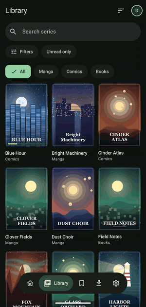
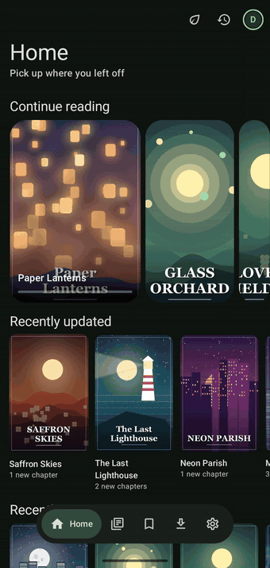
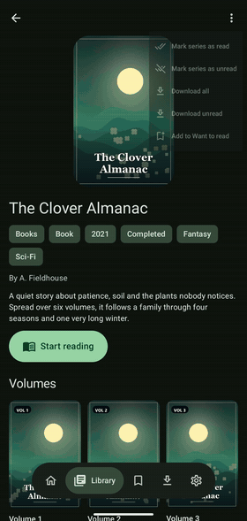
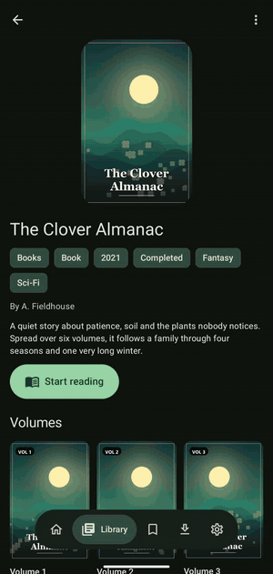
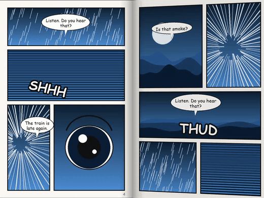
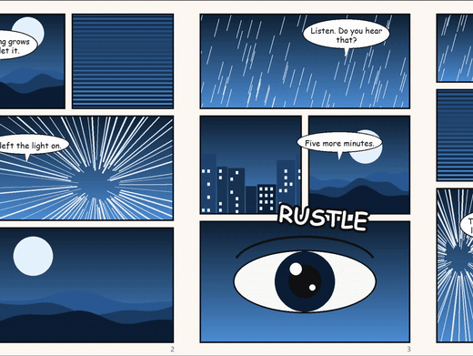
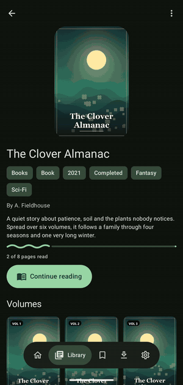
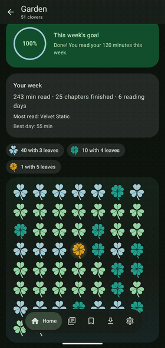
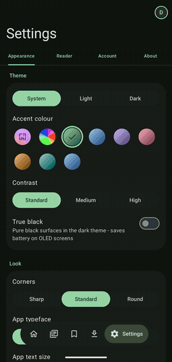

<div align="center">

# Klover

### A native Android client for [Kavita](https://www.kavitareader.com/): read your manga, comics, EPUB books and PDFs, with real foldable support.

[](#requirements)
[](#built-with)
[](#built-with)
[](https://www.kavitareader.com/)
[](#license)
[](#roadmap)



</div>

Klover is an unofficial Android app for people who run a [Kavita](https://www.kavitareader.com/) server and want a
reader that feels at home on their phone. It opens manga, comics, webtoons, EPUB books and PDFs, keeps your progress in
sync with the server, works offline, and uses **two pages on a foldable** like a real book.

I built it for myself first. I read on a Pixel Fold and I wanted the unfolded screen to show two pages, the half-open
posture to turn pages like paper, and the whole app to look like it belongs to Android 15+ (Material 3 Expressive, not a
web page in a wrapper). If you self-host your library and read on Android, it might be what you were looking for too.

> **Not affiliated with Kavita.** Klover is an independent client that talks to your own Kavita server. You need a
> Kavita server to use it.

> **Built with AI assistance.** I made Klover with the help of an AI coding assistant ([Claude Code](https://claude.com/claude-code)).
> It is not generated end to end: I decide what the app does and how it should feel, I test it on real devices, and I
> steer every change. More in [AI assistance](#ai-assistance).

---

## Contents

- [Source code](#source-code)
- [See it](#see-it)
- [Features](#features)
  - [Library and discovery](#library-and-discovery)
  - [Readers: manga, comics, webtoons, EPUB and PDF](#readers-manga-comics-webtoons-epub-and-pdf)
  - [Foldable phones and tablets](#foldable-phones-and-tablets)
  - [Offline reading and downloads](#offline-reading-and-downloads)
  - [Reading stats, time left and the clover garden](#reading-stats-time-left-and-the-clover-garden)
  - [Profiles and accounts](#profiles-and-accounts)
  - [Make it yours](#make-it-yours)
  - [Privacy](#privacy)
- [Supported formats](#supported-formats)
- [Requirements](#requirements)
- [Install](#install)
- [Built with](#built-with)
- [Roadmap](#roadmap)
- [Known issues](#known-issues)
- [AI assistance](#ai-assistance)
- [Feedback and contributing](#feedback-and-contributing)
- [License](#license)

---

## Source code

It is all in this repository, under the [Apache License 2.0](LICENSE): the app in `app/`, the unit tests in
`app/src/test`, and in `tools/` a small fake Kavita server and the scripts that made the demo library for the GIFs.

To build it you need a recent Android Studio (it brings the JDK) and the Android SDK for API 37:

```
./gradlew assembleDebug          # debug build
./gradlew testDebugUnitTest      # unit tests
./gradlew assembleRelease        # shrunk release build with the baseline profile
```

`-PkloverSuffix=.debug` installs a build next to the real app, with its own storage. A release build is signed with
the key described in `keystore.properties` (storeFile, storePassword, keyAlias, keyPassword); that file is not in the
repo, and without it the release build falls back to the debug key.

The code is kept plain on purpose, with few comments. Parts of it were written with an AI assistant, see
[AI assistance](#ai-assistance).

---

## See it

<table>
  <tr>
    <td align="center" width="33%"><br><sub>Hold a cover for the quick view</sub></td>
    <td align="center" width="33%"><br><sub>Downloads with live progress</sub></td>
    <td align="center" width="33%"><br><sub>Native EPUB reader</sub></td>
  </tr>
  <tr>
    <td align="center" colspan="3">&nbsp;&nbsp;<br><sub>Half open, pages turn over the spine like paper &nbsp;&middot;&nbsp; Unfolded, two pages at once</sub></td>
  </tr>
  <tr>
    <td align="center" width="33%"><br><sub>Time left and streak</sub></td>
    <td align="center" width="33%"><br><sub>The clover garden</sub></td>
    <td align="center" width="33%"><br><sub>Themes and accent colours</sub></td>
  </tr>
</table>

---

## Features

### Library and discovery

- **Home** with continue reading, recently updated and recently added rails, plus a one-tap *Continue* button and a
  launcher shortcut that jumps straight back into the last chapter you opened.
- **Library** with search, sorting, filters (genre, tags, people, rating, status and more), unread-only and a type
  switch for Manga, Comics and Books. The grid loads as you scroll.
- **Want to read** shelf, synced with Kavita.
- **Series page** with summary, genres, writers, progress, volumes and chapters, and a *Continue reading* button that
  knows where you stopped.
- **Quick view:** hold any cover and it lifts off the page with its actions underneath: open, mark read or unread,
  download, add to Want to read.
- **Swipe actions** on chapters: swipe one way to mark read, the other to download.
- **Made-up covers** for books and PDFs that have no real cover (or only a first page of text), so the grid never
  shows blank tiles.

### Readers: manga, comics, webtoons, EPUB and PDF

- **Comics and manga** (images and archives): swipe or tap zones to turn pages, pinch and double-tap to zoom, left to
  right or right to left (remembered per series, with a default per library type), single page or two pages.
- **Webtoon mode** for tall strips: one continuous scroll with pinch zoom and optional auto-scroll.
- **EPUB** is drawn by the app itself, not a WebView: paged columns, text size, line spacing, margins, justified text,
  hyphenation, paragraph spacing and first-line indent, serif, sans or mono, and page colours (App, Paper, Sepia, Dark,
  Black). Table of contents and in-book links work.
- **Read aloud** for EPUB with the system voice: the current sentence is highlighted, the page follows the voice, and
  you can set speed and a sleep timer.
- **PDF** through Android's own renderer.
- **Page turn styles:** slide, fade, instant, or a **book flip**.
- **Bookmarks with notes** and a **history** of finished chapters.
- Reading progress goes back to Kavita as you read. Marks you make while the server is away are kept on the device and
  sent when it answers again.

### Foldable phones and tablets

This is the part I care about most, and it was designed on a foldable rather than patched in afterwards.

- **Unfolded:** two pages side by side (two text columns for EPUB), kept clear of the hinge. A cover can stand alone
  like in a printed book.
- **Half open like a book (vertical hinge):** pages lift off the spine and turn over it, a soft spine shadow sits on
  the fold, the app's menu moves to the left page and the content to the right, and sheets open on the right page so
  nothing sits across the fold.
- **Half open like a laptop (horizontal hinge):** *tabletop* mode puts the page above the fold and the controls below
  it.
- **Folded shut:** back to a single page, and your place is kept.
- The long-press quick view also centres itself on the right page in book posture.

### Offline reading and downloads

- Download a chapter, a volume, unread chapters or a whole series, or just the chapters of a volume you want (a volume
  that is one file can be downloaded by chapter ranges).
- **Smart downloads:** while you read, the next few chapters of the series fetch themselves, on Wi-Fi only, and tidy
  up after you read them.
- Wi-Fi-only switch, one to three downloads at once, pause and resume, a notification while the app is in the
  background, and optional *delete after reading*.
- Downloaded comics, PDFs and EPUBs open in the normal readers with no connection. Your offline position is sent to
  Kavita once the server is back.
- Downloads use the same endpoints the readers use, so Kavita's separate download permission is not needed.

### Reading stats, time left and the clover garden

- A **time left** estimate in the reader. It learns how fast *you* read each kind of content (manga, comics, webtoons,
  PDF, text, novels), per series and per sitting, and it checks its own guesses against how long chapters really took.
  Until it has earned your trust it shows a range ("3 to 8 min") instead of pretending to be exact. For EPUBs it also
  learns from downloaded books.
- A **reading streak** (a day counts after a minute of reading) with a warning when today is still open.
- A **weekly goal**, a **stats screen**, and an **accuracy card** that shows how good the estimates have been.
- The **clover garden:** every finished chapter grows a clover. Three leaves are common, four are lucky, five are
  rare and glow gold, and there is a pity counter so luck always arrives eventually. Skimming a chapter does not count.
  There are twelve badges to earn.
- Everything here can be switched off, and **incognito** reading records nothing at all.

### Profiles and accounts

- Sign in with username and password, or with a Kavita API key. Tokens refresh by themselves.
- Keep several accounts on the device (up to twelve) and switch from the profile picker without typing passwords
  again. Each profile has its own name, ring colour, shape and photo.
- Stats, pace, history, bookmarks, streak and app settings are kept per account.
- **Backup:** Settings -> Account -> Backup exports your streak, clovers, badges, reading stats, time-left learning,
  bookmarks and settings to one file, and imports it again (on a new phone, or after a reinstall). It is restored into
  the account you are signed in as. The file never holds your sign-in, and downloads are not included.

### Make it yours

| Area | Options |
| --- | --- |
| Theme | System, light or dark; true black for OLED |
| Colour | Wallpaper colours (dynamic), a custom hue slider, or seven presets |
| Contrast | Standard, medium, high |
| Shape and type | Sharp, standard or round corners; default, serif or mono app typeface |
| Motion | Bouncy, calm or reduced (reduced stops all decorative motion) |
| Reader | Background, tap zone size and swap, page turn, double-tap zoom level, pages on screen, direction by library |
| Books | Typeface, size, spacing, margins, justify, hyphenation, indent, page colour |
| Other | Start tab, haptics, cover size, hold-to-peek on or off |

Klover is English only for now.

### Privacy

- Tokens and API keys are stored encrypted with a key in the Android Keystore.
- No analytics, no ads, no crash-reporting service. The app talks to your Kavita server and nothing else, with one
  optional exception: chapter names for volumes that are a single file can be looked up in MangaDex's public catalogue
  (only the series title and volume number are sent, never your server or login). It is a setting you can turn off, and
  in incognito it only uses what was found earlier.
- **Incognito reading:** no progress sent to the server or kept on the device, nothing counted in stats, and the
  time-left estimate learns nothing from it, including from books you download while it is on.
- **Data saver:** covers are not loaded from the server and made-up covers stand in; hold a cover to load one anyway.

---

## Supported formats

| What Kavita serves | In Klover |
| --- | --- |
| Manga and comic images, and archives such as CBZ and CBR | Paged reader or webtoon reader (Kavita extracts the pages, so anything it can open should work) |
| EPUB | Native text reader with read aloud |
| PDF | PDF reader |

Not supported yet: see [known issues](#known-issues).

---

## Requirements

- Android 15 or newer (API 35).
  Is that too new for your phone? Tell me in an [issue](https://github.com/AnRomanianGuy/Klover-Kavita-Android/issues)
  and if enough people need it, I will make a legacy version that runs on older Android versions.
- A Kavita server you can reach from the phone. Klover is developed against Kavita's current API; if your version
  behaves oddly, please [open an issue](https://github.com/AnRomanianGuy/Klover-Kavita-Android/issues) with the version number.
- On Android 17, connecting to a server on your home network needs the *nearby devices* permission. Klover asks for it
  when you type a local address.

---

## Install

The first release, **v1.0**, is an early build published as an **APK on this repository's [Releases page](https://github.com/AnRomanianGuy/Klover-Kavita-Android/releases)**. There is no store listing.

1. Download `Klover-1.0.apk` on your phone from the Releases page.
2. Open it. Android will ask you to allow installs from that app (your browser or file manager); allow it for this one install.
3. Open Klover, enter your Kavita server address, and sign in with your username and password or an API key.

Updates are manual for now: download the new APK and install it over the old one, your sign-in and data stay. Releases are
signed with the project's own key. The very first v1.0 upload was signed with a development key and was replaced; if you
installed that one, uninstall it once before installing the current one.

---

## Built with

- Kotlin 2.4, Jetpack Compose, **Material 3 Expressive** (`material3 1.5.0-beta01`, where the Expressive APIs are
  public)
- Navigation 3 and the Material 3 adaptive library for list-detail and fold-aware layouts
- Koin, Retrofit 3, OkHttp 5, kotlinx.serialization, Coil 3, DataStore, jsoup
- Android Keystore for secrets, baseline profile for start-up, `PdfRenderer` for PDFs, `TextToSpeech` for read aloud

Roughly 350 unit tests cover the reading-time maths, download logic, offline queues, parsers and the fold layouts;
instrumented tests cover gestures and encryption.

---

## Roadmap

Done so far: the three readers, offline downloads with smart downloads, foldable book mode and tabletop mode, profiles,
reading stats and time-left estimates, themes, and a calmer start-up.

Next, roughly in this order. These are ideas, not promises, and there are no dates:

- [x] **First release: a downloadable APK on GitHub Releases** (v1.0, early)
- [x] Publish the source code
- [ ] Sharper PDF zoom (re-render the visible part at a higher resolution)
- [ ] More languages (the UI is English only today)
- [ ] Bookmarks in the EPUB reader (comics have them already)
- [ ] EPUB tables and SVG images
- [ ] Chapter thumbnails in the volume sheet
- [ ] Downloads and reader settings per account (stats already are)
- [ ] Retry for reading progress that could not be sent because the connection dropped as a chapter closed
- [ ] More testing on real foldables and tablets, and on more Kavita versions

If something here matters to you, say so in an issue. That is how I decide what comes first.

---

## Known issues

I would rather you hear it from me:

- **PDF zoom gets soft.** Pages are rendered at a fixed width, so zooming in a lot on a PDF looks blurry.
- **EPUB limits.** The reader uses its own layout, not a browser. Book CSS only changes the basics (italic, bold, small
  print, centring, hidden bits), tables are flattened to paragraphs, and SVG pictures are not drawn.
- **Most testing was on an emulator.** The foldable features (book flip, spine, tabletop, posture changes) were built and
  checked on the Pixel Fold emulator. Speed was measured on a Pixel 8a. They have not been through a lot of real foldable
  hardware yet.
- **Time left is an estimate.** It is good once it knows you and rough before that. It shows a range for that reason.
- **Resume position differs by one page from Kavita's web reader** when you switch between the two in the middle of a
  chapter (Kavita stores pages read, the web reader resumes at that index).
- **Downloads are per device, not per account**, and are keyed by chapter on one server, so using two different
  servers with overlapping chapter numbers on one phone can clash.
- **A progress save can be lost** if you close a chapter that is not downloaded at the exact moment the connection
  drops (downloaded chapters keep it and send it later).
- **The launch screen colour is fixed to your system theme.** If the in-app theme differs from the system's, the launch
  screen can be the wrong shade for a moment.
- **Material 3 is a beta dependency**, on purpose, so the app may need small changes when the stable release lands.

---

## AI assistance

I want to be upfront about how this was made. Klover was built with the help of an AI coding assistant, [Claude Code](https://claude.com/claude-code),
working in my project at my direction. It was **assisted, not fully generated**:

- **The ideas and the taste are mine.** What the app does, what is in and out of scope, how it should look and move, and
  what counts as done all come from me. A lot of the details exist because I used the app, found something that annoyed
  me, and asked for it to be fixed.
- **The assistant writes and checks code with me.** It reads the project, proposes and writes changes, runs the unit tests,
  lint and builds, and tries the app on an emulator and on real phones. I review what comes out and send it back when it
  is wrong.
- **The demo content is generated too.** The covers, comic pages and book text in the GIFs above are original, drawn and
  written by code, so nothing in them belongs to anyone else.
- **It can still be wrong.** AI-assisted code has bugs like any other, and the [known issues](#known-issues) are real.
  If you find one, please tell me.

If you are curious about the tool, or just want to know what you are installing, that is the whole story.

---

## Feedback and contributing

Klover is a solo project, so replies are quick when I am at my desk and slow when I am not. Bug reports with the Kavita
version, your phone and what you were doing help the most. Ideas are welcome too.

- [Open an issue](https://github.com/AnRomanianGuy/Klover-Kavita-Android/issues): bug reports and ideas are welcome right now.
- Pull requests are welcome. For anything bigger than a small fix, open an issue first so we agree on the direction.

---

## License

Klover's code is licensed under the [Apache License, Version 2.0](LICENSE). In short: you may use, change and share it,
including commercially, as long as you keep the license and copyright notices; it comes with no warranty.

---

<sub>Made by <a href="https://github.com/AnRomanianGuy">AnRomanianGuy</a>, with AI assistance. Klover is not affiliated with, endorsed by or supported by the Kavita project or MangaDex. Kavita is a project of its
own contributors; the name is used here only to say what the app works with. Special thanks to usedcvnt for the ultraviolet album that powered all of the night coding.</sub>

<!--
GIFs in docs/media/ (recorded on a Pixel 9 Pro Fold with demo content whose art and text are all generated for this purpose,
so they can be published freely):
  hero.gif          library -> open a series -> comic page turns
  peek.gif          long-press a cover: lift, blur, options, close
  downloads.gif     download a whole book, progress on the Downloads tab
  reader-epub.gif   EPUB reader: page turns, a figure, the streak pill
  time-left.gif     EPUB reader controls with the time-left pill and streak
  fold-dual.gif     unfolded: two comic pages, turning
  fold-book.gif     half open: pages flipping over the spine
  garden.gif        the clover garden, luck card and badges
  themes.gif        accent colours and light / dark switching live
-->
